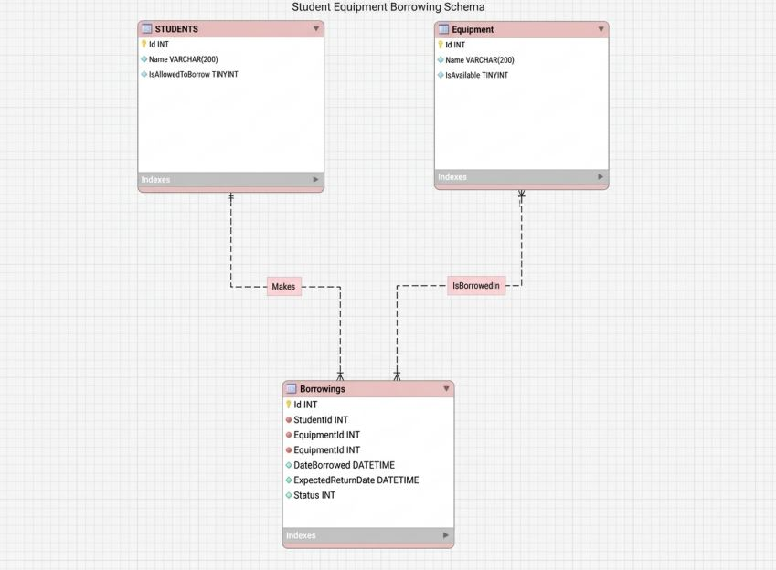

# Campus Equipment Borrowing System

## Part A: System Analysis

### Actors
- **Student**: Expects to borrow available equipment and have borrowing limits enforced.
- **Laboratory Administrator** (Implicit): Expects the system to track equipment status and student borrowing history.

### Use Cases

| Item | Description |
|------|-------------|
| **Use Case** | Borrow Equipment |
| **Primary Actor** | Student |
| **Preconditions** | Student is registered in the system; Equipment exists in the inventory |
| **Main Action** | Student requests to borrow available equipment; System validates student eligibility and equipment availability |
| **Expected Result** | Borrowing record created; Equipment marked as unavailable |
| **Possible Failure** | Student not allowed to borrow; Equipment does not exist; Equipment unavailable; Student reached maximum borrowing limit |

### Domain Concepts

**Student**
- Information: Id, Name, IsAllowedToBorrow
- Rules: Cannot borrow if not allowed
- Not Responsible For: Knowing which equipment is borrowed

**Equipment**
- Information: Id, Name, IsAvailable
- Rules: Can only be borrowed if available
- Not Responsible For: Tracking who borrowed it

**Borrowing**
- Information: Id, StudentId, EquipmentId, DateBorrowed, ExpectedReturnDate, Status
- Rules: Status changes from Active to Returned
- Not Responsible For: Validating student eligibility

---

## Part I: Architecture Explanation

### 1. Solution Structure

**EquipmentBorrowing.Domain**
- Contains core business entities (Student, Equipment, Borrowing, BorrowingStatus)
- Represents the problem domain without technical concerns
- Has NO dependencies on other projects

**EquipmentBorrowing.Application**
- Contains use case implementations (BorrowEquipmentService)
- Defines repository interfaces (IStudentRepository, IEquipmentRepository, IBorrowingRepository)
- Coordinates domain objects to accomplish business operations

**EquipmentBorrowing.Infrastructure**
- Contains technical implementations of repository interfaces
- Currently uses in-memory storage (C# Lists)
- Can be replaced with database implementations without changing other layers

**EquipmentBorrowing.Tests**
- Contains automated tests (structure created, tests can be added later)

**EquipmentBorrowing.Demo**
- Console application demonstrating the system works
- Manually wires up dependencies (Dependency Injection)

### 2. Dependency Direction
```
Demo / Future UI
      │
      ▼
 Application ──────► Domain
      ▲                  
      │                  
 Infrastructure ──────────┘
```

**Explanation:**
- Application layer depends on Domain (uses entities)
- Infrastructure layer depends on both Application (implements interfaces) and Domain (uses entities)
- Domain layer has NO dependencies (pure business logic)
- This follows the Dependency Inversion Principle

### 3. Use Case Mapping

**Use Case: Borrow Equipment**

- **Actor**: Student
- **Use Case**: Borrow Equipment
- **Application Service**: BorrowEquipmentService
- **Domain Objects Used**: Student, Equipment, Borrowing, BorrowingStatus
- **Repository Interfaces Used**: IStudentRepository, IEquipmentRepository, IBorrowingRepository
- **Infrastructure Implementations Used**: InMemoryStudentRepository, InMemoryEquipmentRepository, InMemoryBorrowingRepository

### 4. Reflection

**1. Why should the application service depend on a repository interface instead of directly depending on a database implementation?**

The application service should depend on interfaces to achieve **separation of concerns** and follow the **Dependency Inversion Principle**. This makes the code:
- **Testable**: We can use in-memory repositories for testing without a database
- **Flexible**: We can swap implementations (SQLite, PostgreSQL, API) without changing business logic
- **Maintainable**: Changes to data storage don't affect business rules

**2. Which parts of your current solution could remain unchanged if SQLite were added later?**

- **Domain layer**: All entities (Student, Equipment, Borrowing) would remain exactly the same
- **Application layer**: BorrowEquipmentService and repository interfaces would NOT change
- Only the **Infrastructure layer** would change (we'd add SqliteRepository implementations)

**3. Which project would eventually contain Avalonia Views?**

A new project (e.g., `EquipmentBorrowing.UI` or `EquipmentBorrowing.Desktop`) would contain Avalonia Views. This project would depend on the Application layer to call use cases.

**4. Should an Avalonia button directly execute database queries? Why or why not?**

**NO.** An Avalonia button should NOT directly execute database queries because:
- It violates **separation of concerns** (UI mixing with data access)
- It makes the code **untestable** (UI code is hard to test automatically)
- It creates **tight coupling** (changing database changes the UI)
- The button should call the **Application Service** (BorrowEquipmentService), which coordinates the operation

**5. What part of your implementation represents the actual business operation requested by the actor?**

The **BorrowEquipmentService.ExecuteAsync()** method in the Application layer represents the actual business operation. It:
- Validates all business rules (student allowed, equipment available, borrowing limits)
- Coordinates domain objects and repositories
- Creates the borrowing record when all conditions are met
- Returns clear success/failure messages

---

---

## Laboratory Activity 2: Avalonia UI and MVVM

### 1. Desktop Project

`EquipmentBorrowing.Desktop` is the part of the app that the user actually sees and clicks on. Its job is to:
- Show the list of equipment and active borrowings
- Let the user pick a student, equipment, and return date
- Remember what the user has selected and which page they're on
- Call the existing services (`BorrowEquipmentService`, `ReturnEquipmentService`) when the user clicks a button
- Show a message telling the user if something worked or failed

It uses `EquipmentBorrowing.Application` (to call the services) and `EquipmentBorrowing.Infrastructure` (to get the actual data). It does not contain any of the borrowing rules itself — those all still live in the Domain and Application layers from Lab 1. The Desktop project just shows things and passes user actions along.

### 2. Updated Architecture

```
Avalonia View (MainWindow, EquipmentView, BorrowingsView)
        |
        | Binding / Command
        v
ViewModel (MainViewModel, EquipmentViewModel, BorrowingsViewModel)
        |
        | Application Operation
        v
Application Service (BorrowEquipmentService, ReturnEquipmentService)
        |
        +----------> Domain (Student, Equipment, Borrowing)
        |
        v
Repository Interface (IStudentRepository, IEquipmentRepository, IBorrowingRepository)
        ^
        |
Infrastructure Implementation (InMemoryStudentRepository, InMemoryEquipmentRepository, InMemoryBorrowingRepository)
```

The Domain and Application layers from Lab 1 didn't really change. We just added the Desktop project on top of them.

### 3. Borrow Equipment Flow

1. The user picks a student, picks equipment, and picks a return date in `EquipmentView`.
2. The user clicks **Borrow Equipment**, which runs `EquipmentViewModel.BorrowAsync()`.
3. `BorrowAsync()` only checks simple things first — did the user actually pick a student, pick equipment, and pick a real date.
4. If that's fine, it calls `_borrowEquipmentService.ExecuteAsync(studentId, equipmentId, expectedReturnDate)`.
5. `BorrowEquipmentService` (the same one from Lab 1) checks the real rules: does the student exist, are they allowed to borrow, does the equipment exist, is it available, is the date okay, and has the student already borrowed too many things.
6. If everything checks out, it creates the borrowing, marks the equipment as borrowed, and sends back a success message.
7. That message shows up on screen in `StatusMessage`.
8. The equipment list refreshes so the user sees the updated availability right away.

### 4. Return Equipment Flow

1. The user goes to `BorrowingsView` and clicks on a borrowing in the list.
2. The user clicks **Return Equipment**, which runs `BorrowingsViewModel.ReturnAsync()`.
3. `ReturnAsync()` just checks that something was actually selected.
4. It calls `_returnEquipmentService.ExecuteAsync(borrowingId)`.
5. `ReturnEquipmentService` finds the borrowing, checks it wasn't already returned, marks it as returned, and marks the equipment as available again.
6. The result message is shown to the user.
7. The list refreshes, so the returned item disappears, and the equipment shows as available again if you check the Equipment page.

### 5. Architectural Reflection

**1. Why should the View not call a repository directly?**
- The View is only supposed to show things and take input. If it talked to the repository directly, it could skip all the rules (like checking if a student is allowed to borrow), since repositories don't know about those rules — only the Application layer does.

**2. Why should business rules not be implemented in the ViewModel?**
- If we wrote the rules again inside the ViewModel, we'd have the same rule in two places. If we ever needed to change a rule, we'd have to remember to change it in both places, and it's easy to forget one. Keeping the rule in only one place (the Application layer) avoids that problem.

**3. What is the responsibility of the ViewModel?**
- The ViewModel keeps track of what's on screen — like the list of equipment, what's selected, and any messages to show. It also has the commands (like "Borrow" or "Return") that the buttons use. It checks simple stuff like "did the user pick something," but it doesn't decide if a borrow is actually allowed — it just asks the service.

**4. Why can the existing Application layer work without knowing that Avalonia is being used?**
- Because `BorrowEquipmentService` and `ReturnEquipmentService` only depend on the repository interfaces and the Domain classes — nothing about Avalonia. That means the same service code could be used by a totally different interface (like our console Demo app) without any changes.

**5. What advantage is gained from registering dependencies in one composition point?**
- Setting up everything in one place (`App.axaml.cs`) makes it easy to see how the whole app is wired together. If something needs to change — like using a different repository — we only need to update it in one spot, instead of hunting through the whole codebase.

**6. If the in-memory repository were replaced by SQLite later, which parts of the current interface should remain largely unchanged?**
- Everything except the Infrastructure layer would stay the same — the Domain classes, the Application services, and the whole Desktop project (Views and ViewModels) wouldn't need to change at all. We would only need to write new SQLite versions of the repositories and swap them in during setup.

---

---

## Laboratory Activity 3: Persistent Storage with SQLite and EF Core

### Part B: Database Design

The database uses exactly three tables, matching the three Domain entities
from Lab 1: `Students`, `Equipment`, and `Borrowings`.

**Students**
| Column | Type | Notes |
|---|---|---|
| Id | INTEGER | Primary key |
| Name | TEXT | Required, max length 200 |
| IsAllowedToBorrow | INTEGER | 0 or 1 |

**Equipment**
| Column | Type | Notes |
|---|---|---|
| Id | INTEGER | Primary key |
| Name | TEXT | Required, max length 200 |
| IsAvailable | INTEGER | 0 or 1 |

**Borrowings**
| Column | Type | Notes |
|---|---|---|
| Id | INTEGER | Primary key |
| StudentId | INTEGER | Foreign key → Students.Id |
| EquipmentId | INTEGER | Foreign key → Equipment.Id |
| DateBorrowed | TEXT (DateTime) | Required |
| ExpectedReturnDate | TEXT (DateTime) | Required |
| Status | INTEGER | 0 = Active, 1 = Returned |

**Relationships:** one Student has many Borrowings; one Equipment appears
in many Borrowings. Both foreign keys use `DeleteBehavior.Restrict`, so a
Student or Equipment row cannot be deleted while it still has related
Borrowings — this protects the borrowing history from being silently lost.



The diagram was made in a separate modeling tool and exported as an
image. It reflects the actual database exactly as EF Core created it —
column names, types, and the two foreign keys all match what `dotnet ef`
generated in the `InitialCreate` migration.

---

### Part C: Sample Database Queries

Five representative SQL queries are written directly against the schema
in `docs/database-queries.sql`, before any C# code touches the database:

1. Select all equipment.
2. Filter equipment to only available items.
3. Join active borrowings with the related student and equipment names.
4. Aggregate: count of active borrowings per student.
5. Update a single equipment row's availability.

Writing these first, in plain SQL, made it easier to design the LINQ
queries later in Part M — each of the three required LINQ queries has a
direct SQL counterpart in this file.

---

### Part D: Adding SQLite and EF Core

Two NuGet packages were added to the Infrastructure project:
`Microsoft.EntityFrameworkCore.Sqlite` and
`Microsoft.EntityFrameworkCore.Design` (version 10.0.12), along with the
`dotnet-ef` global tool at the same version, so the tool and the package
versions match.

A version conflict (NU1605) appeared because the Desktop project's
`Microsoft.Extensions.DependencyInjection` package was on a different
version than what EF Core 10.0.12 expected. Pinning Desktop's package to
the same 10.0.12 version resolved it. This is a normal part of adding EF
Core to a solution that already has its own dependency injection setup.

---

### Part E: AppDbContext

`Infrastructure/Data/AppDbContext.cs` defines the bridge between the
Domain entities and the database:

```csharp
public class AppDbContext : DbContext
{
    public DbSet<Student> Students => Set<Student>();
    public DbSet<Equipment> Equipment => Set<Equipment>();
    public DbSet<Borrowing> Borrowings => Set<Borrowing>();

    public AppDbContext(DbContextOptions<AppDbContext> options)
        : base(options) { }
}
```

It takes its configuration through the constructor (`DbContextOptions`)
rather than hardcoding a connection string, so the same class works both
for the running app (pointed at the real SQLite file) and for EF Core's
design-time tools (pointed at wherever `AppDbContextFactory` says).

---

### Part F: Entity Configuration

`OnModelCreating` in `AppDbContext` configures each entity with the
Fluent API:

- Every entity's `Id` is set as the primary key.
- `Name` on `Student` and `Equipment` is required, with a max length of
  200 characters.
- `Borrowing.Status` (a C# enum) is stored as a plain integer with
  `HasConversion<int>()`, so SQLite stores `0` for Active and `1` for
  Returned instead of a string.
- `Borrowing.StudentId` and `Borrowing.EquipmentId` are configured as
  foreign keys to `Students.Id` and `Equipment.Id`, both using
  `DeleteBehavior.Restrict` — a Student or Equipment row cannot be
  deleted while a Borrowing still references it.

No explicit unique constraints were added. `Student.Name` and
`Equipment.Name` are not required to be unique, since two students could
share a name, and two identical pieces of equipment (e.g. two of the same
model of laptop) would need separate rows with the same name in a real
deployment. EF Core does automatically create indexes on both foreign
keys (`IX_Borrowings_StudentId`, `IX_Borrowings_EquipmentId`), confirmed
in DB Browser for SQLite, which speeds up the joins used in Part M.

---

### Part G: Migration and Database Creation

The `InitialCreate` migration was generated and applied with `dotnet ef`:

dotnet ef migrations add InitialCreate --project src/EquipmentBorrowing.Infrastructure
dotnet ef database update --project src/EquipmentBorrowing.Infrastructure

The database file location is decided by
`AppDbContextFactory.GetDbPath()`, which returns:

%LOCALAPPDATA%\EquipmentBorrowing\equipmentborrowing.db


An absolute path under the user's LocalAppData folder was used instead of
a relative path, so the database always lands in a predictable, per-user
location no matter which folder the app is launched from — a relative
path had initially put the file inside the Infrastructure project folder
by accident, which is not appropriate for a real application's data.

`IDesignTimeDbContextFactory` is implemented so that `dotnet ef` commands
can construct an `AppDbContext` at design time (when creating a
migration), without needing the full dependency injection container that
the running app uses.

---

### Part H: EF Core Repositories

Three repository classes were added to
`Infrastructure/Repositories/`, each implementing the same interface as
its in-memory counterpart from Lab 1, but backed by `AppDbContext`
instead of a `List<T>`:

- `EfStudentRepository`
- `EfEquipmentRepository`
- `EfBorrowingRepository`

Each method either reads with `AsNoTracking()` for display-only data, or
keeps tracking on when the calling service is going to modify and save
the entity. See Part O for the full explanation of which is used where
and why.

The original in-memory repositories (`InMemoryStudentRepository`,
`InMemoryEquipmentRepository`, `InMemoryBorrowingRepository`) were kept
in the project rather than deleted. They still compile and satisfy the
same interfaces, so they remain available as a reference or for testing
without a real database, even though the app no longer uses them at
runtime.

---

### Part I: Confirming the Application Services

`BorrowEquipmentService` and `ReturnEquipmentService` needed **no
changes** to work with the new EF Core repositories. Both classes depend
only on `IStudentRepository`, `IEquipmentRepository`, and
`IBorrowingRepository` — never on `InMemory...` classes, `AppDbContext`,
or anything EF Core or SQLite specific.

This confirms the same point made in the Lab 1 and Lab 2 reflection
questions: because the services depend on interfaces, not on any specific
storage technology, swapping in-memory storage for a real database only
required writing new repository classes (Part H) and updating dependency
injection (Part J) — no business logic anywhere had to change.

---

### Part J: Switching Dependency Injection to EF Core

`App.axaml.cs` was updated so the app registers the EF Core repositories
instead of the in-memory ones, and applies migrations automatically on
startup:

```csharp
services.AddDbContext<AppDbContext>(
    options => options.UseSqlite($"Data Source={dbPath}"),
    ServiceLifetime.Transient);

services.AddTransient<IStudentRepository, EfStudentRepository>();
services.AddTransient<IEquipmentRepository, EfEquipmentRepository>();
services.AddTransient<IBorrowingRepository, EfBorrowingRepository>();
```

**Why `Transient` instead of `Singleton`.** In Lab 2, the in-memory
repositories were registered as Singletons, so the same `List<T>` stayed
alive for the whole run of the app. A database `DbContext` should not be
kept alive that way — a desktop app has no natural "request" boundary
like a web app does to scope it to, so `Transient` gives each repository
call its own short-lived `DbContext`, which is the safest default for a
desktop application.

**Applying migrations at startup.** Right after building the service
provider, `DatabaseInitializer.Initialize()` calls
`context.Database.Migrate()`. This applies any migrations that have not
yet run, and does nothing if the database is already up to date — it
never recreates or drops the database, which matches the lab's
requirement that the app "not recreate the database at every launch."

---

### Part K: Persistence Test

To confirm the data survives a full restart, not just navigation within
the running app:

1. Borrowed equipment as a student (Alice Santos, Laptop Dell XPS 15) —
   the equipment list updated to "Unavailable" immediately.
2. Confirmed the new borrowing appeared in Active Borrowings.
3. **Closed the app completely** and reopened it.
4. Checked Equipment — 101 Laptop Dell XPS 15 was still "Unavailable."
5. Checked Active Borrowings — the same borrowing was still listed.
6. Clicked Return Equipment — the app confirmed the return, the
   borrowing disappeared from Active Borrowings, and the equipment
   returned to "Available."

Every step behaved correctly, which confirms the data is genuinely being
written to and read from the SQLite file, not just held in memory for the
lifetime of the running process.

---

### Part L: Seeding Initial Data

`DatabaseInitializer.SeedIfEmpty()` inserts starting data only if the
relevant table is currently empty:

```csharp
if (!context.Students.Any())
{
    context.Students.Add(new Student(1, "Alice Santos", true));
    context.Students.Add(new Student(2, "Bob Reyes", false));
}

if (!context.Equipment.Any())
{
    context.Equipment.Add(new Equipment(101, "Laptop Dell XPS 15"));
    context.Equipment.Add(new Equipment(102, "Projector Epson"));
    context.Equipment.Add(new Equipment(103, "Arduino Kit"));

    var camera = new Equipment(104, "Canon Camera");
    camera.MarkAsBorrowed();
    context.Equipment.Add(camera);
}
```

Checking `.Any()` before seeding means the app can be closed and reopened
any number of times without duplicating rows or throwing a primary key
error — a plain "always insert on startup" approach would fail the second
time the app runs.

Equipment 104 (Canon Camera) is seeded already unavailable, by calling
`MarkAsBorrowed()` right after construction, so the app has a real
example of an unavailable item to demonstrate the "equipment
unavailable" failure case without needing to borrow something first.

No `Borrowings` are seeded, on purpose — the persistence test in Part K
needed to create a real borrowing through the running app, not start with
one already in the database.

---

### Part M: LINQ Queries

Three LINQ queries were added across the repositories, each demonstrating
a different kind of query:

1. **Filtering** — `EfEquipmentRepository.GetAvailableAsync()` returns
   only equipment where `IsAvailable` is true, using a `Where` clause.
2. **Joining** — `EfBorrowingRepository.GetActiveBorrowingsAsync()` joins
   `Borrowings` with `Students` and `Equipment` to return real names
   instead of raw foreign key IDs. This is documented in full, with the
   generated SQL, in Part N (Query 2).
3. **Aggregating** — `EfBorrowingRepository.GetActiveBorrowingsCountByStudentIdAsync()`
   counts a student's active borrowings directly in the database with
   `CountAsync`, rather than loading every row into memory and counting
   in C#. This is documented in full in Part N (Query 3).

Adding Query 2 (the join) also fixed a real bug: the Active Borrowings
screen was showing "Student #1" and "Equipment #101" instead of actual
names, because `Borrowing` only stores foreign key IDs, not navigation
properties to the related `Student` or `Equipment`. A new
`ActiveBorrowingDetails` class in `Application/Models/` was introduced to
carry the joined result — `BorrowingId`, `StudentName`, `EquipmentName`,
`DateBorrowed`, `ExpectedReturnDate` — and `BorrowingsViewModel` and
`BorrowingsView.axaml` were updated to bind to it instead of the raw
`Borrowing` entity.

---

### Part N: Inspecting Generated SQL

EF Core translates LINQ queries into SQL before sending them to SQLite.
Using LINQ does not eliminate SQL — EF Core still builds and executes real
SQL statements underneath. Below are three LINQ queries from the app, the
SQL EF Core generated for each, and what that SQL does.

#### Query 1: Retrieve all equipment (Equipment page)

**LINQ Query** (`EfEquipmentRepository.GetAllAsync`)
```csharp
return await _context.Equipment
    .AsNoTracking()
    .ToListAsync(cancellationToken);
```

**Generated SQL**
```sql
SELECT "e"."Id", "e"."IsAvailable", "e"."Name"
FROM "Equipment" AS "e"
```

**Explanation**
EF Core selects only the three columns the `Equipment` entity has, from
the `Equipment` table. No joins or filters are needed since every row is
returned. `AsNoTracking()` tells EF Core not to track these entities for
changes, since this list is only for display.

---

#### Query 2: Active borrowings with student and equipment names

**LINQ Query** (`EfBorrowingRepository.GetActiveBorrowingsAsync`)
```csharp
return await (
    from b in _context.Borrowings.AsNoTracking()
    join s in _context.Students.AsNoTracking() on b.StudentId equals s.Id
    join e in _context.Equipment.AsNoTracking() on b.EquipmentId equals e.Id
    where b.Status == BorrowingStatus.Active
    select new ActiveBorrowingDetails
    {
        BorrowingId = b.Id,
        StudentName = s.Name,
        EquipmentName = e.Name,
        DateBorrowed = b.DateBorrowed,
        ExpectedReturnDate = b.ExpectedReturnDate
    }
).ToListAsync(cancellationToken);
```

**Generated SQL**
```sql
SELECT "b"."Id" AS "BorrowingId", "s"."Name" AS "StudentName",
       "e"."Name" AS "EquipmentName", "b"."DateBorrowed",
       "b"."ExpectedReturnDate"
FROM "Borrowings" AS "b"
INNER JOIN "Students" AS "s" ON "b"."StudentId" = "s"."Id"
INNER JOIN "Equipment" AS "e" ON "b"."EquipmentId" = "e"."Id"
WHERE "b"."Status" = 0
```

**Explanation**
The LINQ `join` clauses become SQL `INNER JOIN`s. EF Core joins the
`Borrowings` table to `Students` and `Equipment` on their foreign keys, so
the query returns real names instead of raw IDs. The `where` clause
becomes `WHERE "b"."Status" = 0`, since `BorrowingStatus.Active` is stored
as the integer `0`. This fixed a UI bug where the Active Borrowings screen
showed "Student #1" instead of "Alice Santos".

---

#### Query 3: Count of active borrowings for a student

**LINQ Query** (`EfBorrowingRepository.GetActiveBorrowingsCountByStudentIdAsync`)
```csharp
return await _context.Borrowings
    .CountAsync(b => b.StudentId == studentId && b.Status == BorrowingStatus.Active, cancellationToken);
```

**Generated SQL**
```sql
SELECT COUNT(*)
FROM "Borrowings" AS "b"
WHERE "b"."StudentId" = @studentId AND "b"."Status" = 0
```

**Explanation**
`CountAsync` becomes SQL's `COUNT(*)`. Only a single number is returned,
not the actual rows, so the database does the counting instead of EF Core
loading every borrowing into memory. This query enforces the rule that a
student cannot have more than 3 active borrowings at once.

---

### Part O: Tracking and No-Tracking Queries

EF Core tracks entities by default so it can detect changes and save them
later. Tracking has a small memory and performance cost, so it should only
be used when an entity will actually be modified.

**Read-only queries use `AsNoTracking()`**

- `EfStudentRepository.GetByIdAsync` and `GetAllAsync` — students are only
  displayed (in the borrow dropdown), never changed.
- `EfEquipmentRepository.GetAllAsync` — the equipment list is only
  displayed.
- `EfBorrowingRepository.GetActiveBorrowingsAsync` — the active borrowings
  list is only displayed.

**Tracked queries (no `AsNoTracking()`)**

- `EfEquipmentRepository.GetByIdAsync` — used by `BorrowEquipmentService`
  and `ReturnEquipmentService`, which call `MarkAsBorrowed()` or
  `MarkAsReturned()` on the result and then save it. EF Core needs to
  track the entity to detect that change.
- `EfBorrowingRepository.GetByIdAsync` — used by `ReturnEquipmentService`,
  which calls `MarkAsReturned()` on the result and saves it.

**Why this matters**

If `AsNoTracking()` were used on `GetByIdAsync` for equipment or
borrowings, EF Core would not notice that `MarkAsBorrowed()` or
`MarkAsReturned()` changed the object, and `SaveChangesAsync()` would have
nothing to save. Tracking must stay on for any entity that will be
modified and saved. Conversely, using tracking on a display-only list
would waste memory tracking objects that are never going to change.

---

### Part P: Confirming UI and Database Separation

The application keeps a clear separation between the user interface and
the database, following the same layered architecture from Labs 1 and 2:

```
Avalonia View (EquipmentView, BorrowingsView)
↓ binding / command
ViewModel (EquipmentViewModel, BorrowingsViewModel)
↓ calls
Application Service (BorrowEquipmentService, ReturnEquipmentService)
↓ uses
Repository Interface (IStudentRepository, IEquipmentRepository, IBorrowingRepository)
↓ implemented by
Ef...Repository (EfStudentRepository, EfEquipmentRepository, EfBorrowingRepository)
↓ uses
AppDbContext → SQLite database
```

**What this means in practice**

- No `.axaml` view or ViewModel references `AppDbContext`, EF Core, or
  SQLite anywhere. They only know about `IStudentRepository`,
  `IEquipmentRepository`, and `IBorrowingRepository`.
- All SQL is generated inside the three `Ef...Repository` classes in the
  Infrastructure project. No SQL, LINQ-to-database queries, or EF Core
  types appear in Desktop, Application, or Domain.
- `BorrowEquipmentService` and `ReturnEquipmentService` are unchanged from
  Lab 1 and Lab 2. Switching from in-memory storage to SQLite in Lab 3
  only required writing new repository classes and updating the
  dependency injection setup in `App.axaml.cs` — no service, ViewModel,
  or View code needed to change.
- This confirms the same conclusion reached in the Lab 1 and Lab 2
  reflection questions: because every layer only depends on interfaces
  from the layer below it, the real database technology can change
  without forcing changes anywhere else in the application.


  
---

## Laboratory Activity 4: PostgreSQL, Multi-Item Checkout and Histories

> Lab 5 update: the API now owns the database connection. Where this section says to set user-secrets on the Desktop project, or to start the desktop with the test settings, use the Lab 5 section at the end of this file instead. The secrets belong to `src/EquipmentBorrowing.Api`, and the API reads `EQUIPMENT_BORROWING_DB`, `EQUIPMENT_BORROWING_FIXED_DATE` and `EQUIPMENT_BORROWING_FAULT`.

**Pair:** Ellainne G. Cabasag (2023304057) and Floramay S. Balofinos (2024302506) 

Lab 4 continues the same application. Lab 3 stored data in SQLite. Lab 4 replaces SQLite with
PostgreSQL, adds a transactional multi-item checkout, histories, search and student/equipment
management. The sections above describe Labs 1 to 3 and are kept as they were. Where the Lab 3
text says SQLite, that is correct for Lab 3. From Lab 4 on, the application uses PostgreSQL.

### 1. Scope: the 14 required use cases

All users are Laboratory Staff / Equipment Custodian (the primary actor). The supporting system is PostgreSQL.

| Use case | Where in the application |
|---|---|
| UC-01 View Equipment Catalog | **Equipment** page |
| UC-02 Find Available Equipment | **Equipment** page: search box and "Show available equipment only" |
| UC-03 Borrow Equipment | **Equipment** page: tick one item, choose student and return date |
| UC-04 View Active Borrowings | **Active Borrowings** page (with search) |
| UC-05 Return Equipment | **Active Borrowings** page: select a row, "Return Equipment" |
| UC-06 Check Out Multiple Equipment Items | **Equipment** page: tick two or three items (all-or-nothing) |
| UC-07 View Student Borrowing History | **Student History** page |
| UC-08 View Equipment Borrowing History | **Equipment History** page |
| UC-09 Search, Filter, and Sort Borrowings | **Borrowing Search** page |
| UC-12 Register Student | **Students** page |
| UC-13 Update Student Information | **Students** page |
| UC-14 Change Student Borrowing Eligibility | **Students** page: Permit / Restrict |
| UC-15 Register Equipment | **Manage Equipment** page |
| UC-16 Update Equipment Information | **Manage Equipment** page |

The use-case diagram, catalog, adapted suite and traceability matrix are in `docs/`:
`Use-Case-Diagram-Lab4.png`, `Lab4_Use_Case_Catalog_and_Diagram.docx`, `Lab4_Use_Case_Suite.docx`
and `Lab4_Traceability_Matrix.docx`. Test evidence is in `docs/evidence/`.

### 2. Prerequisites

- Windows with the **.NET 10 SDK**
- **PostgreSQL 18** and **pgAdmin 4**
- **Git**
- **Visual Studio 2026** (Community) or **VS Code** with the C# Dev Kit
- The EF Core command-line tool: `dotnet tool install --global dotnet-ef`

### 3. Installation and secret-free configuration

1. Clone the repository and open the folder:

   ```powershell
   git clone https://github.com/Ellainne21/EquipmentBorrowing.git
   cd EquipmentBorrowing
   ```

2. In pgAdmin (or `psql`) create two **empty** databases:

   ```sql
   CREATE DATABASE "Equipment_BorrowingDB";   -- main database
   CREATE DATABASE equipmentborrowing_test;   -- disposable database for failure and rollback tests
   ```

3. Store the connection strings with **dotnet user-secrets**. They are saved outside the repository
   (under `%APPDATA%\Microsoft\UserSecrets\`), so **no password is ever committed to Git**.
   Replace `<your-password>` with your own PostgreSQL password:

   ```powershell
   dotnet user-secrets set "ConnectionStrings:Main" "Host=localhost;Port=5432;Database=Equipment_BorrowingDB;Username=postgres;Password=<your-password>" --project src/EquipmentBorrowing.Api
   dotnet user-secrets set "ConnectionStrings:Test" "Host=localhost;Port=5432;Database=equipmentborrowing_test;Username=postgres;Password=<your-password>" --project src/EquipmentBorrowing.Api
   ```

   `DatabaseSettings` reads these keys. If one is missing, the application stops and prints the exact command to set it.

### 4. Migrations and initial data

The schema is created by two EF Core migrations in `src/EquipmentBorrowing.Infrastructure/Migrations`:

- `InitialPostgres`: tables, primary keys and foreign keys
- `AddIdentifiersReturnDateAndConstraints`: normalized identifier keys, the return date, unique indexes and check constraints

They are applied **automatically at startup** by `DatabaseInitializer` (called from the composition root `App.axaml.cs`, never from a View or ViewModel).
That is how a clean database, including the test database, gets its schema and initial data: just start the application against it.

The `dotnet ef` tool can also be used. **It always targets the MAIN database** (the design-time factory reads `ConnectionStrings:Main`):

```powershell
dotnet ef migrations list --project src/EquipmentBorrowing.Infrastructure                # shows which migrations are applied
dotnet ef database update --project src/EquipmentBorrowing.Infrastructure                # applies pending migrations to the main database
dotnet ef database drop --force --project src/EquipmentBorrowing.Infrastructure          # DELETES the main database (close pgAdmin connections first)
```

To start again with a clean **test** database, drop and recreate it in pgAdmin (connected to the `postgres` database), then run the application in test mode:

```sql
DROP DATABASE equipmentborrowing_test WITH (FORCE);
CREATE DATABASE equipmentborrowing_test;
```

**Initial data** is added only when the database is completely empty. It never overwrites existing data:

| Students | Equipment | Borrowings |
|---|---|---|
| 2026-0001 Alice Santos (eligible) | LAP-001 Laptop Dell XPS 15 | Alice returned LAP-001 |
| 2026-0002 Bob Reyes (**restricted**) | PRJ-001 Projector Epson | Bob returned ARD-001 |
| 2026-0003 Carla Mendoza (no history) | ARD-001 Arduino Kit | Alice has CAM-001 **active** (so CAM-001 is unavailable) |
| 2026-0004 Daniel Cruz (no history) | CAM-001 Canon Camera, MIC-001 USB Microphone (no history) | |

**Database integrity (BR-16)** is enforced by PostgreSQL itself, not only by the application:

| Rule | Database object |
|---|---|
| Unique student number, ignoring case and spaces | unique index `UX_Students_StudentNumberKey` |
| Unique equipment identifier, ignoring case and spaces | unique index `UX_Equipment_IdentifierKey` |
| An item has at most one active borrowing | partial unique index `UX_Borrowings_OneActivePerEquipment` (`WHERE "Status" = 0`) |
| Due date after checkout date | check constraint `CK_Borrowings_ExpectedAfterCheckout` |
| Return date not before checkout date | check constraint `CK_Borrowings_ReturnNotBeforeCheckout` |
| Every borrowing has a real student and a real item | foreign keys, `ON DELETE RESTRICT` |

The "key" columns hold the trimmed, upper-case text. The application uses the same normalization, so the application check and the database index always agree.

### 5. Running the application and the tests

```powershell
dotnet run --project src/EquipmentBorrowing.Desktop     # main database
dotnet test                                             # 51 automated tests, no database needed
```

To use the **disposable test database**, set an environment variable first. The window title then shows **[TEST DATABASE]**:

```powershell
$env:EQUIPMENT_BORROWING_DB="Test"
dotnet run --project src/EquipmentBorrowing.Desktop
```

`.vscode/launch.json` contains the same choices for F5 in VS Code.

**Controlled failure seams.** They work **only** with the test database and are used to demonstrate rollback and the unknown-outcome rule:

| Variable | Effect |
|---|---|
| `EQUIPMENT_BORROWING_FAULT=AfterFirstWrite` | The checkout fails after the first item was written, before the commit (tests atomic rollback) |
| `EQUIPMENT_BORROWING_FAULT=LostCommit` | The connection is "lost" after PostgreSQL accepted the commit (tests the unknown-outcome message) |

### 6. Architecture

```
Avalonia View  ->  ViewModel  ->  Application Service  ->  Repository abstraction  ->  EF Core Infrastructure  ->  PostgreSQL
```

| Project | Responsibility | References |
|---|---|---|
| `EquipmentBorrowing.Domain` | Student, Equipment, Borrowing and their own rules (normalization, return rules) | nothing |
| `EquipmentBorrowing.Application` | Services, repository and unit-of-work **interfaces**, result types | Domain |
| `EquipmentBorrowing.Infrastructure` | EF Core `AppDbContext`, mappings, migrations, repositories, unit of work | Application, Domain |
| `EquipmentBorrowing.Desktop` | Avalonia Views, ViewModels, dependency injection (composition root) | Application, Infrastructure |
| `EquipmentBorrowing.Tests` | xUnit tests with a fake in-memory unit of work | Application, Domain |

Views and ViewModels never run SQL, never create a `DbContext` and never run migrations. They call Application services and show the result.
Domain and Application never reference Avalonia or EF Core.

Services return a result instead of throwing for expected problems. `OperationResult` has four outcomes: **Success**, **Rejected** (a business rule said no), **Failed** (a known failure, nothing was changed) and **Unknown** (the commit outcome cannot be known). `QueryResult` separates "found", "no matches" and "database problem", so the screens can show an empty state or an error state, never the wrong one (BR-19).

### 7. DbContext and dependency-injection lifetimes

Decision: **short-lived contexts, never shared between operations.**

| Piece | Lifetime | Why |
|---|---|---|
| `AppDbContext` factory (`AddDbContextFactory`) | singleton | Creates a new context whenever one is needed. A desktop window stays open for hours, so one shared context would keep old tracked data. |
| Checkout and return | **one new context and one transaction per operation** (`EfBorrowingUnitOfWork`) | The operation re-reads current data inside its own transaction, so it cannot use stale data. |
| Read-only repositories | transient, every query uses `AsNoTracking()` | Nothing is cached, so lists always show what is in the database. |
| Student and equipment edits | transient repository; the edit **attaches** the object and marks only the edited columns as changed | A stale edit screen cannot overwrite eligibility or availability. |
| ViewModels and services | transient | They hold screen state only. No database state lives in them. |

Reason for the decision: with the long-lived tracked context of Lab 3, the equipment list could show **stale availability after a return**. Fresh contexts and no-tracking reads removed that problem.

### 8. Transaction decisions (checkout and return)

The transaction boundary is the **application service**, through `IBorrowingUnitOfWork`. The service decides what must succeed together. Infrastructure only provides the transaction.

1. Begin a transaction on a **new context**.
2. Lock the student row and the requested equipment rows (`SELECT ... FOR UPDATE`), so two staff members cannot take the same item at the same time.
3. **Revalidate everything inside the transaction** (BR-15): the student exists and is eligible, every item exists, no item has an active borrowing and is available, and the student's active count plus the new items stays at 3 or less. Items must be distinct and there must be at least two for a multi-item checkout.
4. Write all borrowings and all availability changes, then **commit once**. Everything is saved, or nothing is.
5. The partial unique index is the last line of defense. If two requests still collide, PostgreSQL rejects the second write and the application reports a conflict (`ConflictException` becomes **Rejected**) instead of creating a duplicate.
6. A known failed write rolls back and reports **Failed**. It never reports success.
7. **Unknown outcome (BR-18):** if the connection is lost while committing, the service reports **Unknown**. It does **not** retry automatically and does **not** claim a rollback. The screen refreshes so the staff member can see the real state before deciding.

Returning equipment uses the same boundary: the borrowing and the equipment change together. A repeated or stale return is rejected, and history is never deleted (BR-14).

### 9. Responsive loading

Lists and histories load asynchronously (`async`/`await`) with a loading indicator, an empty state and an error state with **Retry**.
Each page counts its loads. If a slow old load finishes after a newer one, its result is ignored, so the screen never shows outdated data.
Search, filter and sort (BR-17) run **in PostgreSQL**, not in memory. The borrowing id is the tie-breaker, so the order is always stable.

### 10. Verification

- **Automated tests:** `dotnet test` runs 51 tests on the real services with a fake in-memory unit of work. They cover the checkout rules (including exactly at the limit, duplicates, fewer than two), rollback after a failed write, the unknown outcome, returns and the domain rules.
- **Manual and database evidence:** `docs/evidence/` holds screenshots with a database readback for the main scenarios, including restart checks. Multi-item checkout rejections (ineligible student, unavailable item, over the limit, invalid date) and the lost-commit retry are verified by the automated tests (`CheckoutRuleTests`); `A03-single-borrow` and `A06-checkout` show the live behaviour and the rollback.
- **Traceability:** `docs/Lab4_Traceability_Matrix.docx` connects each of the 14 use cases to the implementation, the business rules and the evidence (acceptance checks A01 to A19).

### 11. Git history

Earlier work is preserved. Lab 4 was developed in small commits: the PostgreSQL switch, the domain and database rules, transactional checkout and return, each page, the tests and the documents. Use `git log --oneline` to see it.


## Laboratory Activity 5: API Integration and Acceptance Testing

Lab 5 adds an ASP.NET Core REST API (`src/EquipmentBorrowing.Api`) over the existing application services and EF Core / PostgreSQL code. The Avalonia desktop now reads and writes application data only through that API, using asynchronous HTTP. The Lab 4 business rules (BR-01 to BR-19) and the use cases UC-01 to UC-09 and UC-12 to UC-16 are unchanged.

### 1. Architecture

```
Avalonia desktop  --HTTP/JSON-->  Api  -->  Application services  -->  Infrastructure (EF Core)  -->  PostgreSQL
(Contracts only)                  (controllers, errors)  (Lab 4 rules)   (repositories, unit of work)
```

| Project | Role |
| --- | --- |
| `EquipmentBorrowing.Domain` | Entities and business rules |
| `EquipmentBorrowing.Application` | Use-case services and repository interfaces |
| `EquipmentBorrowing.Infrastructure` | EF Core, PostgreSQL, migrations, test seams |
| `EquipmentBorrowing.Contracts` | JSON request and response types shared by the API and the desktop |
| `EquipmentBorrowing.Api` | REST API (`/api/v1`), error middleware, OpenAPI description |
| `EquipmentBorrowing.Desktop` | Avalonia UI. References only `Contracts`. Uses `HttpClient` |
| `tests/EquipmentBorrowing.Tests` | The 51 Lab 4 tests plus 4 Lab 5 tests (55 in total), all passing |

Before and after the boundary change:

| | Lab 4 | Lab 5 |
| --- | --- | --- |
| Desktop project references | Application, Infrastructure | Contracts only |
| Where the DbContext lives | Desktop start-up code | API process only |
| Where rules and transactions run | Inside the desktop process | Inside the API (same Lab 4 services and unit of work) |

The desktop has no DbContext, no SQL, no Npgsql package and no connection string. To check it:

```powershell
dotnet list src\EquipmentBorrowing.Desktop reference
```

The only project reference listed must be `EquipmentBorrowing.Contracts`.

### 2. Prerequisites

.NET 10 SDK and PostgreSQL, with two databases: `Equipment_BorrowingDB` (the real data) and `equipmentborrowing_test` (a disposable database used for all Lab 5 tests). See Lab 4, sections 2 and 3, for installing PostgreSQL and creating the databases. No Docker, cloud service or authentication is needed.

### 3. Secret-free configuration

The API is the only part that connects to PostgreSQL, so the connection strings are stored in .NET user-secrets for the **API** project. They are never stored in the repository. These are the same commands as in Lab 4, section 3, now for the API project:

```powershell
dotnet user-secrets set "ConnectionStrings:Main" "Host=localhost;Port=5432;Database=Equipment_BorrowingDB;Username=postgres;Password=<your-password>" --project src/EquipmentBorrowing.Api
dotnet user-secrets set "ConnectionStrings:Test" "Host=localhost;Port=5432;Database=equipmentborrowing_test;Username=postgres;Password=<your-password>" --project src/EquipmentBorrowing.Api
```

Replace `<your-password>` with your own password. Do not commit it, and do not paste it into screenshots or logs.

### 4. Migrations and test data

Migrations live in the Infrastructure project. The API applies pending migrations when it starts (the log says `Database migrations are up to date.`). If the database cannot be reached, the API still starts and database routes answer 500 until it can be reached.

The API does not add the Lab 4 demo data. A new empty database stays empty. For repeatable tests, load the controlled dataset (4 students, 7 equipment items, 4 borrowings) with the reset option. It works only with the test database (the variable below and a database name that contains "test"), and it exits when it finishes:

```powershell
$env:EQUIPMENT_BORROWING_DB="Test"
$env:EQUIPMENT_BORROWING_FIXED_DATE="2026-11-10"
dotnet run --project src/EquipmentBorrowing.Api -- --reset-test-data
```

To start from a clean test database, drop and recreate it in pgAdmin (one statement at a time), then run the reset command above:

```sql
DROP DATABASE equipmentborrowing_test WITH (FORCE);
CREATE DATABASE equipmentborrowing_test;
```

`dotnet ef` still targets the main database (see Lab 4, section 4).

### 5. Running the API and the desktop separately

Use two PowerShell windows opened in the repository folder.

Window 1 (API, test database):

```powershell
$env:EQUIPMENT_BORROWING_DB="Test"
$env:EQUIPMENT_BORROWING_FIXED_DATE="2026-11-10"
dotnet run --project src/EquipmentBorrowing.Api
```

Wait for `Now listening on: http://localhost:5080`. Leave this window running. To use the real database, start the API without these two variables.

Window 2 (desktop):

```powershell
$env:EQUIPMENT_BORROWING_DB="Test"
dotnet run --project src/EquipmentBorrowing.Desktop
```

The desktop variable only adds `[TEST DATABASE]` to the window title. The API decides which database is used. Without the variable, the desktop starts normally.

The API works without the desktop. Stop both programs before running `dotnet build`, because they lock the build files.

### 6. Environment variables

| Variable | Used by | Meaning |
| --- | --- | --- |
| `EQUIPMENT_BORROWING_DB=Test` | API | Use the disposable test database |
| `EQUIPMENT_BORROWING_DB=Test` | Desktop | Add `[TEST DATABASE]` to the window title (label only) |
| `EQUIPMENT_BORROWING_FIXED_DATE=2026-11-10` | API | Fixed calendar date for repeatable tests (test database only) |
| `EQUIPMENT_BORROWING_FAULT` | API | Test-only failure, honoured only with the test database: `AfterFirstWrite` (fails after the first item of a checkout, before the commit), `LostCommit` (the commit succeeds, then the connection is "lost"), `BrokenConnection` (the database cannot be reached) |
| `EQUIPMENT_BORROWING_API_URL` | Desktop | API address. Default `http://localhost:5080` |

### 7. Endpoint contract

All routes start with `/api/v1`. Bodies are JSON. Dates are `YYYY-MM-DD`. Failures use `{ "code": "...", "message": "..." }`.

| ID | Method and route | Success | Errors |
| --- | --- | --- | --- |
| API-01 | GET `/equipment` (`available`, optional `search`) | 200 | 400 |
| API-02 | GET `/students` (optional `search`) | 200 | 400 |
| API-03 | GET `/students/{id}` | 200 | 400, 404 |
| API-04 | POST `/students` | 201 + `Location` | 400, 409 |
| API-05 | PUT `/students/{id}` | 200 | 400, 404, 409 |
| API-06 | PATCH `/students/{id}/eligibility` | 200 (same value is a no-op) | 400, 404 |
| API-07 | GET `/equipment/{id}` | 200 | 400, 404 |
| API-08 | POST `/equipment` | 201 + `Location` | 400, 409 |
| API-09 | PUT `/equipment/{id}` (no `isAvailable`) | 200 | 400, 404, 409 |
| API-10 | POST `/borrowings` | 201 + `Location` | 400, 404, 409 |
| API-11 | POST `/checkout-requests` (atomic, 2 to 3 items) | 201 | 400, 404, 409 |
| API-12 | POST `/borrowings/{id}/return` | 200 | 400, 404, 409 |
| API-13 | GET `/borrowings/{id}` | 200 | 400, 404 |
| API-14 | GET `/borrowings` (`search`, `status`, `sort`, `direction`) | 200 | 400 |
| API-15 | GET `/students/{id}/borrowings` | 200 | 400, 404 |
| API-16 | GET `/equipment/{id}/borrowings` | 200 | 400, 404 |

- Error codes: `validation_error`, `not_found`, `method_not_allowed`, `conflict`, `server_error`, `outcome_unknown`. Error bodies never contain credentials or stack traces.
- Unknown routes return 404 and wrong methods return 405.
- A field the contract does not define (for example `isAvailable` on an equipment update) is rejected with 400.
- A 500 with the code `outcome_unknown` means a checkout may have been committed but the answer was lost (BR-18). The client never retries it automatically. If the API cannot be reached, there is no HTTP status at all.
- Extension: `search` on API-01 is an optional addition to the supplied contract. It keeps the Lab 4 catalog search working.

The machine-readable description is `docs/openapi/openapi-v1.json`. It is generated from the running API:

```powershell
curl.exe -s -o docs\openapi\openapi-v1.json http://localhost:5080/openapi/v1.json
```

### 8. Trying the endpoints

`scripts\Invoke-Lab5.ps1` sends a request to `http://localhost:5080`, prints the status and the body, and appends them to `docs\lab5\evidence\<label>-requests.txt`.

```powershell
Set-ExecutionPolicy -Scope Process -ExecutionPolicy Bypass -Force
. .\scripts\Invoke-Lab5.ps1
Invoke-Lab5 T01 GET /api/v1/students
Invoke-Lab5 T02 POST /api/v1/students '{"studentNumber":"ST-500","fullName":"Eli Tan","contact":null}'
```

### 9. Failure handling in the desktop

| Situation | What the client receives | What the user sees |
| --- | --- | --- |
| API not running | No HTTP response | "No connection: ..." |
| API running, database broken | HTTP 500 `server_error` | "Server error: ..." with the advice to refresh and try again |
| Commit answer lost | HTTP 500 `outcome_unknown` | "Result unknown: ..." The app does not retry. The user refreshes the lists to see what was saved |
| Rule or duplicate rejected | 409 | "Not allowed: ..." (lists refreshed) |
| Invalid input | 400 | "Check your input: ..." |

All loads are asynchronous, show a loading state, and ignore outdated results. Lists are refreshed from the API after every change.

### 10. Acceptance tests T01 to T08

Each test has a request log (`docs/lab5/evidence/T0x-requests.txt`, written by the helper script) and pgAdmin readbacks taken before and after every change. Failures, fixes and retests are in the evidence record.

| Test | Subject | Evidence files |
| --- | --- | --- |
| T01 | Reads, lists, missing and empty results, OpenAPI | `T01-*` |
| T02 / T02R | Students and eligibility (the first run lacked some readbacks, so it was repeated as T02R) | `T02-*`, `T02R-*` |
| T03 | Equipment create, edit, protected state | `T03-*` |
| T04 / T04R | Single borrow and return (repeated as T04R for missing readbacks) | `T04-*`, `T04R-*` |
| T05 | Multi-item checkout, limit, rollback after a failed write | `T05-*` |
| T06 | Histories, search, filter, sort | `T06-*` |
| T07 | Avalonia over HTTP, refresh after changes, no database code in the desktop | `T07-*` |
| T08 | API stopped vs 500 vs unknown outcome, recovery | `T08-*` |

### 11. Evidence and traceability

- Baseline record, T01 to T08 results, failures, fixes and retests: `docs/lab5/Lab5_Evidence_Record.md`.
- Traceability matrix (API, use cases, rules, code and evidence): `docs/lab5/Lab5_Traceability_Matrix.md`.
- The authentic Lab 4 submission is tagged `lab4-submitted` (commit `6e5dab2`). The completed Lab 5 revision is tagged `lab5-submitted`.

### 12. Known limitations

- No authentication, Docker or cloud deployment (not required for this lab).
- The acceptance tests ran against the disposable test database only.
- The error banner on the Students page can overlap the Retry button. This is cosmetic.

### 13. Pair

Ellainne G. Cabasag (2023304057) and Floramay S. Balofinos (2024302506).